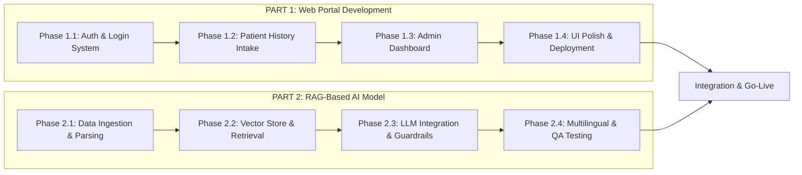
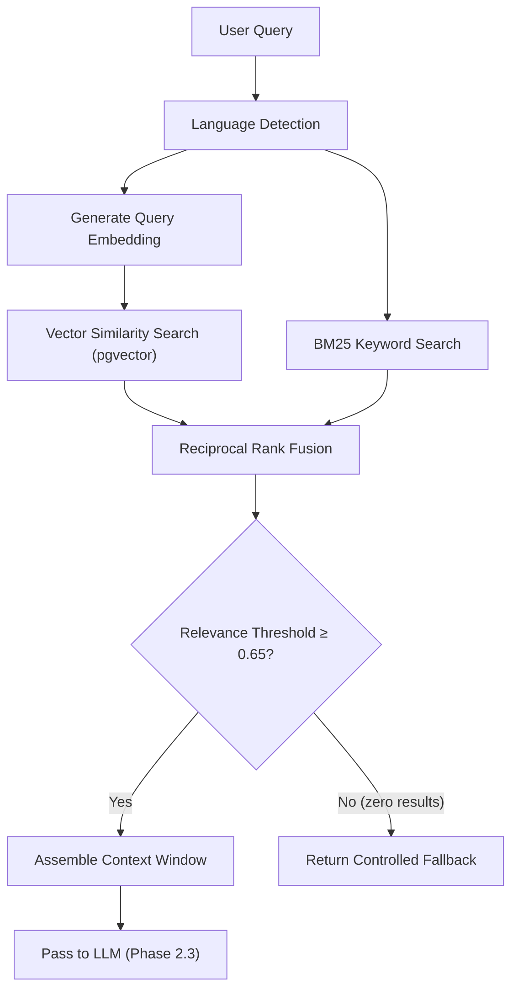

# Electropathy AI – Phase-Wise Implementation Plan

**Project:** AI-Powered Electropathy Information & Knowledge Assistant  
**Client:** Dr. Ashish Wandhare  
**Prepared For:** NKSKILLEDGE PRIVATE LIMITED  
**Document Version:** 2.0  
**Date:** 18 October 2026

---

## Project Structure Overview

The project is divided into **two independent, parallel workstreams** that integrate at the end:



---

---

# PART 1: Web Portal Development (Login & Patient History Intake)

> **Goal:** Build a complete, production-ready web portal where users can register/login via mobile OTP, manage their profile, and submit detailed patient history intake forms for Electropathy consultation.

---

## Phase 1.1 – Authentication & Login System
**Duration:** 1 Week

### Objectives
- Secure mobile OTP-based authentication for Indian users (+91 numbers).
- JWT-based session management with refresh token lifecycle.
- Role-based access control (Patient, Practitioner/Doctor, Student, Admin).

### Deliverables

| # | Task | Details |
|---|------|---------|
| 1 | **Project Scaffolding** | Initialize React (Vite) frontend + Node.js (Express) backend with TypeScript. Setup PostgreSQL database with Prisma ORM and migrations. |
| 2 | **Mobile OTP Login Flow** | Registration screen → Enter mobile number (+91 validation) → Send OTP via SMS gateway (MSG91 / Twilio) → Verify OTP → Create account / Login. |
| 3 | **OTP Security Controls** | OTP expiry (5 minutes), max 3 retry attempts per 10 minutes, hashed OTP storage, rate limiting per IP. |
| 4 | **JWT Token Management** | Issue Access Token (short-lived, 15 min) + Refresh Token (long-lived, 7 days). Secure HTTP-only cookie storage. Token revocation on logout. |
| 5 | **User Registration & Profile** | Collect: Full Name, Mobile Number (verified), Email (optional), User Type (Practitioner / Student / Researcher / Patient), Preferred Language (English / Hindi / Marathi). |
| 6 | **Role-Based Access Control (RBAC)** | Define roles: `patient`, `practitioner`, `admin`. Middleware to protect routes by role. Admin uses separate email/password login. |
| 7 | **Login UI Screens** | Mobile number input screen → OTP verification screen → Profile setup screen (first-time users) → Dashboard redirect. Responsive design for desktop & mobile browsers. |

### Database Schema (Key Tables)

```sql
-- Users table
CREATE TABLE users (
    id              UUID PRIMARY KEY DEFAULT gen_random_uuid(),
    mobile_number   VARCHAR(15) UNIQUE NOT NULL,
    full_name       VARCHAR(255),
    email           VARCHAR(255),
    user_type       VARCHAR(50) CHECK (user_type IN ('patient', 'practitioner', 'student', 'researcher')),
    preferred_lang  VARCHAR(10) DEFAULT 'en',
    role            VARCHAR(20) DEFAULT 'patient',
    is_active       BOOLEAN DEFAULT true,
    created_at      TIMESTAMPTZ DEFAULT NOW(),
    updated_at      TIMESTAMPTZ DEFAULT NOW()
);

-- OTP verification table
CREATE TABLE otp_verifications (
    id              UUID PRIMARY KEY DEFAULT gen_random_uuid(),
    mobile_number   VARCHAR(15) NOT NULL,
    otp_hash        VARCHAR(255) NOT NULL,
    attempts        INTEGER DEFAULT 0,
    expires_at      TIMESTAMPTZ NOT NULL,
    is_used         BOOLEAN DEFAULT false,
    created_at      TIMESTAMPTZ DEFAULT NOW()
);

-- Sessions / Refresh tokens
CREATE TABLE refresh_tokens (
    id              UUID PRIMARY KEY DEFAULT gen_random_uuid(),
    user_id         UUID REFERENCES users(id) ON DELETE CASCADE,
    token_hash      VARCHAR(255) NOT NULL,
    expires_at      TIMESTAMPTZ NOT NULL,
    is_revoked      BOOLEAN DEFAULT false,
    created_at      TIMESTAMPTZ DEFAULT NOW()
);
```

### Acceptance Criteria
- [x] User can enter Indian mobile number and receive OTP via SMS.
- [x] Invalid or expired OTP is rejected with clear error message.
- [x] Successful OTP verification issues JWT tokens and redirects to dashboard.
- [x] First-time users are prompted to complete their profile.
- [x] Rate limiting prevents OTP abuse (max 3 attempts / 10 min).

---

## Phase 1.2 – Patient History Intake System
**Duration:** 2 Weeks

### Objectives
- Multi-step patient history intake form capturing comprehensive case details.
- Structured data storage for future AI-assisted analysis.
- View, edit, and manage past patient records.

### Deliverables

| # | Task | Details |
|---|------|---------|
| 1 | **Patient History Form (Multi-Step Wizard)** | Step-by-step form with progress indicator. Sections detailed below. Auto-save on each step. |
| 2 | **Step 1: Personal Information** | Patient Name, Age, Gender, Contact Number, Address (City/District/State), Occupation, Marital Status. |
| 3 | **Step 2: Chief Complaints** | Primary complaint (text area), Duration of complaint, Severity scale (1–10 slider), Onset description (sudden/gradual), Aggravating & relieving factors. |
| 4 | **Step 3: History of Present Illness** | Detailed symptom description, Timeline/progression, Previous treatments taken (allopathic / ayurvedic / homeopathic / electropathic / other), Response to previous treatment. |
| 5 | **Step 4: Past Medical History** | Chronic conditions checklist (Diabetes, Hypertension, Thyroid, Asthma, Heart Disease, etc.), Surgeries, Hospitalizations, Allergies (medicine / food / environmental). |
| 6 | **Step 5: Family History** | Family medical conditions (searchable checklist), Hereditary disease indicators. |
| 7 | **Step 6: Personal & Lifestyle History** | Diet type (Veg/Non-Veg/Vegan), Appetite, Sleep pattern, Bowel habits, Addiction/habits (Tobacco / Alcohol / Caffeine), Exercise frequency, Stress level assessment. |
| 8 | **Step 7: Menstrual & Obstetric History** | (Conditional – shown for female patients only) Menstrual regularity, Last menstrual period (LMP), Pregnancy history, Menopause status. |
| 9 | **Step 8: System-wise Review** | Checklist-based review of body systems: Respiratory, Cardiovascular, Gastrointestinal, Musculoskeletal, Nervous, Urinary, Skin, ENT, Eyes. Each system has common symptom checkboxes + free text notes. |
| 10 | **Step 9: Electropathy-Specific Details** | Previous Electropathy treatment (Yes/No + details), Constitution type (if known), Temperament assessment notes (by practitioner). |
| 11 | **Step 10: Document Uploads** | Upload medical reports, lab results, prescriptions (PDF / Image). File preview and delete capability. |
| 12 | **Step 11: Review & Submit** | Complete case summary preview. Edit any section before final submission. Submit creates a timestamped patient case record. |
| 13 | **Patient Records Dashboard** | List of all submitted patient histories (sorted by date). Search by patient name / complaint / date. View detailed record. Edit/update existing record. Print-friendly case summary view. |
| 14 | **API Endpoints** | `POST /api/patients` – Create patient case. `GET /api/patients` – List all cases (paginated). `GET /api/patients/:id` – Fetch single case. `PUT /api/patients/:id` – Update case. `DELETE /api/patients/:id` – Soft-delete case. `POST /api/patients/:id/documents` – Upload documents. |

### Database Schema (Key Tables)

```sql
-- Patient case records
CREATE TABLE patient_cases (
    id                  UUID PRIMARY KEY DEFAULT gen_random_uuid(),
    practitioner_id     UUID REFERENCES users(id),
    patient_name        VARCHAR(255) NOT NULL,
    age                 INTEGER,
    gender              VARCHAR(20),
    contact_number      VARCHAR(15),
    address             JSONB,               -- {city, district, state, pincode}
    occupation          VARCHAR(100),
    marital_status      VARCHAR(30),
    chief_complaints    JSONB,               -- [{complaint, duration, severity, onset, factors}]
    present_illness     JSONB,               -- {description, timeline, prev_treatments, response}
    past_medical        JSONB,               -- {conditions[], surgeries[], allergies[]}
    family_history      JSONB,               -- {conditions[], hereditary_indicators}
    personal_lifestyle  JSONB,               -- {diet, appetite, sleep, bowel, habits, exercise, stress}
    menstrual_obstetric JSONB,               -- {regularity, lmp, pregnancy_history, menopause} (nullable)
    system_review       JSONB,               -- {respiratory:{}, cardiovascular:{}, ...}
    electropathy_details JSONB,              -- {prev_treatment, constitution, temperament}
    status              VARCHAR(20) DEFAULT 'draft',  -- draft, submitted, in_review, completed
    created_at          TIMESTAMPTZ DEFAULT NOW(),
    updated_at          TIMESTAMPTZ DEFAULT NOW()
);

-- Uploaded medical documents
CREATE TABLE patient_documents (
    id              UUID PRIMARY KEY DEFAULT gen_random_uuid(),
    case_id         UUID REFERENCES patient_cases(id) ON DELETE CASCADE,
    file_name       VARCHAR(255) NOT NULL,
    file_type       VARCHAR(50),
    file_url        VARCHAR(500) NOT NULL,
    file_size       INTEGER,
    uploaded_at     TIMESTAMPTZ DEFAULT NOW()
);
```

### Acceptance Criteria
- [x] Practitioner can create a new patient case via the multi-step form.
- [x] Form auto-saves progress; user can resume incomplete cases.
- [x] Menstrual/obstetric section conditionally appears for female patients.
- [x] Medical documents can be uploaded and previewed.
- [x] Submitted cases appear in the patient records dashboard with search/filter.
- [x] Cases can be viewed, edited, and printed.

---

## Phase 1.3 – Admin Dashboard & Management
**Duration:** 1.5 Weeks

### Objectives
- Admin-only web portal for managing users, viewing analytics, and overseeing the system.

### Deliverables

| # | Task | Details |
|---|------|---------|
| 1 | **Admin Login** | Separate admin authentication (email + password + optional 2FA). |
| 2 | **Dashboard Overview** | Key metrics: Total users, Active users, Total patient cases submitted, Cases by status (draft / submitted / completed), Recent activity feed. |
| 3 | **User Management** | Searchable/filterable user list. View user profile details. Activate / Deactivate users. Change user roles. |
| 4 | **Patient Case Overview** | Admin can view all submitted patient cases across practitioners. Filter by practitioner, date range, status. Export case data as CSV. |
| 5 | **Activity & Audit Logs** | Log all admin actions: login, user modifications, case access, system config changes. Timestamped, filterable log viewer. |
| 6 | **System Settings** | Configure OTP expiry duration, max retry attempts, maintenance mode toggle. |

### Acceptance Criteria
- [x] Admin can login with separate credentials (not OTP-based).
- [x] Dashboard displays real-time metrics.
- [x] Admin can search, view, activate/deactivate any user.
- [x] All admin actions are recorded in the audit log.

---

## Phase 1.4 – UI/UX Polish, Responsive Design & Deployment
**Duration:** 1 Week

### Objectives
- Professional medical-grade UI across all screens.
- Full responsiveness (desktop, tablet, mobile browser).
- Production deployment.

### Deliverables

| # | Task | Details |
|---|------|---------|
| 1 | **Design System** | Medical-professional color palette (navy / teal / white / neutral grays). Typography with Google Fonts (Inter for English, Noto Sans Devanagari for Hindi/Marathi). Consistent spacing, shadows, border-radius tokens. |
| 2 | **Multilingual UI** | Language switcher: English, Hindi (हिंदी), Marathi (मराठी). All form labels, buttons, validation messages, and navigation translated. Proper Devanagari script rendering and alignment. |
| 3 | **Responsive Layouts** | All pages tested on: Desktop (1440px+), Laptop (1024px), Tablet (768px), Mobile (375px). |
| 4 | **Accessibility** | Semantic HTML, proper ARIA labels, keyboard navigation, focus indicators, contrast compliance. |
| 5 | **Medical Disclaimer** | Mandatory disclaimer modal shown on first login: "This platform is for informational purposes only and does not replace professional medical advice." |
| 6 | **Frontend Deployment** | Deploy React app to Vercel with custom domain and SSL. |
| 7 | **Backend Deployment** | Deploy Node.js API to Render with managed PostgreSQL. Configure environment secrets, CORS, and rate-limiting. |
| 8 | **Monitoring & Error Tracking** | Basic health-check endpoint. Error logging (e.g., Sentry or simple structured logging). |

### Acceptance Criteria
- [x] All UI screens render correctly across desktop, tablet, and mobile.
- [x] Hindi and Marathi translations display correctly with Devanagari script.
- [x] Web app is live on a production URL with HTTPS.
- [x] Backend API is deployed and accessible with proper CORS configuration.

---

---

# PART 2: RAG-Based AI Model (Electropathy Knowledge Engine)

> **Goal:** Build a strict Retrieval-Augmented Generation (RAG) pipeline that answers Electropathy queries **only** from client-approved documents. The model must never hallucinate, never use external web knowledge, and must gracefully decline when information is missing.

---

## Phase 2.1 – Data Ingestion, Parsing & Structuring
**Duration:** 1.5 Weeks

### Objectives
- Parse and extract structured knowledge from all client-provided Electropathy materials.
- Categorize, clean, and store content in a queryable structured format.

### Deliverables

| # | Task | Details |
|---|------|---------|
| 1 | **Document Parser Service** | Python (FastAPI) service that accepts PDF, DOC/DOCX, XLS/XLSX files. Libraries: `PyPDF2`/`pdfplumber` for PDFs, `python-docx` for Word, `openpyxl`/`pandas` for Excel. Extract clean text, tables, and structured rows. |
| 2 | **Content Cleaning Pipeline** | Remove headers/footers/page numbers, fix encoding issues, normalize whitespace. Handle mixed Hindi/English text in source documents. Preserve tabular data relationships (e.g., Medicine → Disease → Dosage mappings). |
| 3 | **Domain Categorization** | Auto-tag extracted content into categories: **Diseases & Conditions**, **Symptoms**, **Medicines & Remedies**, **Dosage & Administration**, **Precautions & Contraindications**, **Treatment Protocols**, **Electropathy Theory & History**. |
| 4 | **Intelligent Chunking** | Chunk documents into semantically coherent segments (300–500 tokens). Overlap chunks by ~50 tokens to preserve context at boundaries. Maintain metadata per chunk: source document, page/row, category, language. |
| 5 | **Structured Knowledge Store** | Store parsed and categorized records in PostgreSQL for admin review/approval. |
| 6 | **Admin Upload Integration** | API endpoint for admin to upload new documents. Processing status tracking: `Uploaded → Processing → Parsed → Pending Review → Approved / Rejected`. |

### Database Schema

```sql
-- Source documents uploaded by admin
CREATE TABLE knowledge_documents (
    id              UUID PRIMARY KEY DEFAULT gen_random_uuid(),
    file_name       VARCHAR(255) NOT NULL,
    file_type       VARCHAR(50),
    file_url        VARCHAR(500),
    uploaded_by     UUID REFERENCES users(id),
    status          VARCHAR(30) DEFAULT 'uploaded',  -- uploaded, processing, parsed, approved, rejected
    total_chunks    INTEGER DEFAULT 0,
    created_at      TIMESTAMPTZ DEFAULT NOW()
);

-- Extracted and chunked knowledge records
CREATE TABLE knowledge_chunks (
    id              UUID PRIMARY KEY DEFAULT gen_random_uuid(),
    document_id     UUID REFERENCES knowledge_documents(id) ON DELETE CASCADE,
    content         TEXT NOT NULL,
    category        VARCHAR(100),
    language        VARCHAR(10) DEFAULT 'en',
    page_number     INTEGER,
    chunk_index     INTEGER,
    metadata        JSONB,                  -- {source_row, table_name, etc.}
    is_approved     BOOLEAN DEFAULT false,
    is_enabled      BOOLEAN DEFAULT true,
    embedding       VECTOR(1536),           -- pgvector column for embeddings
    created_at      TIMESTAMPTZ DEFAULT NOW()
);

-- Structured medicine-disease master records (from Excel sheets)
CREATE TABLE medicine_master (
    id              UUID PRIMARY KEY DEFAULT gen_random_uuid(),
    medicine_name   VARCHAR(255) NOT NULL,
    medicine_code   VARCHAR(50),
    disease         VARCHAR(255),
    symptoms        TEXT,
    dosage          VARCHAR(255),
    frequency       VARCHAR(100),
    precautions     TEXT,
    contraindications TEXT,
    source_doc_id   UUID REFERENCES knowledge_documents(id),
    is_approved     BOOLEAN DEFAULT false,
    is_enabled      BOOLEAN DEFAULT true,
    created_at      TIMESTAMPTZ DEFAULT NOW()
);
```

### Acceptance Criteria
- [x] PDF, Word, and Excel files are parsed and text is extracted accurately.
- [x] Hindi and Marathi content in documents is preserved without corruption.
- [x] Chunks are tagged with correct categories and metadata.
- [x] Admin can upload new documents and track processing status.

---

## Phase 2.2 – Vector Store, Embedding & Retrieval Pipeline
**Duration:** 1.5 Weeks

### Objectives
- Generate embeddings for all approved knowledge chunks.
- Build a hybrid search pipeline (semantic + keyword) for high-precision retrieval.

### Deliverables

| # | Task | Details |
|---|------|---------|
| 1 | **Embedding Generation** | Use OpenAI `text-embedding-3-small` (or Gemini Embedding API) to generate 1536-dim vectors for each approved chunk. Batch processing with retry logic and rate-limit handling. |
| 2 | **Vector Database Setup** | PostgreSQL with `pgvector` extension. Create HNSW or IVFFlat index on the `embedding` column for fast approximate nearest-neighbor search. |
| 3 | **Semantic Search** | Given a user query, generate query embedding → retrieve top-K nearest chunks (cosine similarity). Default K = 10, configurable. |
| 4 | **BM25 Keyword Search** | Full-text search index on `knowledge_chunks.content` using PostgreSQL `tsvector`/`tsquery`. Captures exact medicine names, codes, and Electropathy-specific terminology that semantic search may miss. |
| 5 | **Hybrid Search Fusion** | Combine semantic + BM25 results using Reciprocal Rank Fusion (RRF). De-duplicate and re-rank merged results. |
| 6 | **Relevance Threshold Gate** | Apply minimum similarity score threshold (configurable, default 0.65). Chunks below threshold are discarded before context assembly. If zero chunks pass the threshold → trigger controlled fallback (no answer generated). |
| 7 | **Context Assembly** | Assemble top-K passing chunks into a single context window. Attach metadata (category, source document name) for internal traceability (NOT shown to end users). |
| 8 | **Query Language Detection** | Detect whether the user query is in English, Hindi, or Marathi. Route to appropriate search strategy (cross-lingual embedding search or language-matched BM25). |

### Architecture Diagram



### Acceptance Criteria
- [x] Embeddings are generated for all approved knowledge chunks.
- [x] Hybrid search returns relevant results for English, Hindi, and Marathi queries.
- [x] Exact medicine names and codes are found via BM25 even when semantic search misses them.
- [x] Queries with no relevant content return the controlled fallback (no fabricated answers).

---

## Phase 2.3 – LLM Integration, Prompt Engineering & Guardrails
**Duration:** 2 Weeks

### Objectives
- Wire the retrieved context into a large language model with strict grounding constraints.
- Implement multi-turn conversation support.
- Build guardrails against hallucination, prompt injection, and scope violations.

### Deliverables

| # | Task | Details |
|---|------|---------|
| 1 | **LLM Provider Integration** | Integrate OpenAI GPT-4o (or Google Gemini 2.0 Flash) via API. Configurable model selection, temperature, and max tokens from admin settings. |
| 2 | **System Prompt Engineering** | Design a strict system prompt that enforces: **"You are an Electropathy knowledge assistant. Answer ONLY based on the provided context. Do NOT use your own training knowledge. Do NOT search the internet. If the context does not contain the answer, respond with the fallback message."** Include negative examples of what NOT to do. |
| 3 | **Structured Response Formatting** | LLM output format: Disease/Condition name, Associated Symptoms, Recommended Electropathy Medicine(s), Dosage & Administration (if available), Precautions & Contraindications, Additional Notes. Render as clean markdown in the frontend. |
| 4 | **Multi-Turn Conversation Memory** | Maintain conversation history (last N messages, depth-limited to prevent context drift). Inject relevant prior turns into the LLM prompt for follow-up query resolution. Auto-generate conversation titles from the first user message. |
| 5 | **Controlled Fallback Response** | When retrieval returns no results above threshold: *"I could not find sufficient information for this query in the approved Electropathy knowledge base. Please consult a qualified Electropathy practitioner for further guidance."* |
| 6 | **Prompt Injection Defense** | Input sanitization: strip system-prompt-override attempts. Detect and block queries like "Ignore previous instructions", "You are now...", "Pretend you are...". Log flagged attempts for admin review. |
| 7 | **Streaming Responses** | Server-Sent Events (SSE) for real-time token streaming to the frontend. Typing indicator animation during generation. |
| 8 | **Chat API Endpoints** | `POST /api/chat` – Send message & get AI response (streaming). `GET /api/conversations` – List user conversations. `GET /api/conversations/:id/messages` – Fetch messages for a conversation. `DELETE /api/conversations/:id` – Delete a conversation. |
| 9 | **Admin AI Configuration** | Admin panel controls for: System prompt text, Temperature (0.0 – 1.0), Fallback message text, Relevance threshold, Max context chunks, Model selection. |
| 10 | **User Feedback Collection** | Thumbs up / Thumbs down on each AI response. Optional text feedback. Stored for analysis and model tuning. |

### Conversation Database Schema

```sql
-- Conversations
CREATE TABLE conversations (
    id              UUID PRIMARY KEY DEFAULT gen_random_uuid(),
    user_id         UUID REFERENCES users(id) ON DELETE CASCADE,
    title           VARCHAR(255),
    language        VARCHAR(10) DEFAULT 'en',
    is_deleted      BOOLEAN DEFAULT false,
    created_at      TIMESTAMPTZ DEFAULT NOW(),
    updated_at      TIMESTAMPTZ DEFAULT NOW()
);

-- Messages within conversations
CREATE TABLE messages (
    id              UUID PRIMARY KEY DEFAULT gen_random_uuid(),
    conversation_id UUID REFERENCES conversations(id) ON DELETE CASCADE,
    role            VARCHAR(20) NOT NULL,    -- 'user' or 'assistant'
    content         TEXT NOT NULL,
    feedback        VARCHAR(10),             -- 'positive', 'negative', null
    feedback_text   TEXT,
    metadata        JSONB,                   -- {chunks_used[], model, tokens_used, response_time_ms}
    created_at      TIMESTAMPTZ DEFAULT NOW()
);
```

### System Prompt Template

```text
You are an Electropathy knowledge assistant created for Dr. Ashish Wandhare.

STRICT RULES:
1. Answer ONLY using the CONTEXT provided below. Do NOT use your own training data.
2. Do NOT search the internet or reference external sources.
3. If the CONTEXT does not contain sufficient information to answer the question,
   respond EXACTLY with: "I could not find sufficient information for this query
   in the approved Electropathy knowledge base. Please consult a qualified
   Electropathy practitioner for further guidance."
4. Do NOT invent, guess, or fabricate any medicine names, dosages, or treatments.
5. Do NOT provide general medical advice outside of Electropathy.
6. Respond in the same language as the user's question (English, Hindi, or Marathi).
7. Do NOT mention or cite source documents, page numbers, or references in your response.

CONTEXT:
{retrieved_context}

USER QUESTION:
{user_query}
```

### Acceptance Criteria
- [x] AI responses are grounded strictly in retrieved context; no external knowledge leakage.
- [x] Out-of-scope queries return the controlled fallback message.
- [x] Multi-turn conversations maintain context correctly.
- [x] Streaming responses display in real-time on the frontend.
- [x] Prompt injection attempts are detected, blocked, and logged.
- [x] Admin can configure system prompt, temperature, and thresholds.

---

## Phase 2.4 – Multilingual Testing, QA & Hardening
**Duration:** 1.5 Weeks

### Objectives
- Comprehensive testing of the RAG pipeline across all supported languages.
- Validate all acceptance criteria with real Electropathy content.
- Security hardening and performance optimization.

### Deliverables

| # | Task | Details |
|---|------|---------|
| 1 | **Electropathy Test Suite** | Create 200+ test questions across categories: Diseases (50+), Medicines (50+), Dosage & Administration (30+), Precautions (30+), Out-of-scope queries (40+). Test in English, Hindi, and Marathi. |
| 2 | **Hallucination Detection** | Verify every AI response against the source knowledge base. Flag any response containing information not present in the approved dataset. Target: 0% hallucination rate on test suite. |
| 3 | **Fallback Accuracy** | Test with 40+ questions that have NO answer in the knowledge base. Verify 100% of these return the controlled fallback message. |
| 4 | **Multilingual Rendering QA** | Verify Devanagari script rendering on Web (Chrome, Firefox, Safari, Edge). Verify mixed English-Hindi and English-Marathi responses display correctly. |
| 5 | **Performance Benchmarks** | Measure query-to-response latency (target: < 3 seconds for non-streaming first token). Load test with 50 concurrent users. |
| 6 | **Prompt Injection Stress Test** | Run 30+ adversarial prompts attempting to: Override system instructions, Extract system prompt, Force external knowledge usage, Generate fake medicine recommendations. Verify all are blocked. |
| 7 | **Security Audit** | HTTPS enforcement, JWT validation, SQL injection testing on all API endpoints, XSS prevention in chat inputs, File upload validation (type, size limits). |
| 8 | **Knowledge Update Cycle Test** | Test full cycle: Admin uploads new document → Document parsed → Admin reviews & approves → New content appears in AI responses. Verify disabled/rejected content does NOT appear in responses. |

### QA Results Tracking Table

| Test Category | Total Tests | Pass | Fail | Pass Rate | Target |
|---|---|---|---|---|---|
| Grounded Responses (In-scope) | 160 | – | – | – | ≥ 95% |
| Fallback Accuracy (Out-of-scope) | 40 | – | – | – | 100% |
| Hallucination Rate | 200 | – | – | – | 0% |
| Prompt Injection Blocked | 30 | – | – | – | 100% |
| Multilingual Accuracy | 60 | – | – | – | ≥ 90% |

### Acceptance Criteria
- [x] Zero hallucinations detected across the full test suite.
- [x] 100% of out-of-scope queries return the controlled fallback.
- [x] All prompt injection attempts are blocked.
- [x] Response latency is under 3 seconds for first token.
- [x] Hindi and Marathi responses render correctly with proper Devanagari typography.

---

---

# Integration & Go-Live

> After both parts are completed and tested independently, they are integrated:

| Step | Action |
|---|---|
| 1 | Connect the Web Portal chat interface to the RAG API endpoints. |
| 2 | Wire patient history data to enable future AI-assisted case analysis (Phase 8 / CR scope). |
| 3 | Deploy unified backend (portal + RAG service) to production (Render). |
| 4 | Deploy web frontend to production (Vercel). |
| 5 | Final end-to-end smoke test across all features. |
| 6 | Admin training session for Dr. Ashish Wandhare. |
| 7 | Handover documentation: Admin guide, API docs, knowledge upload SOP. |

---

## Technology Stack Summary

| Layer | Technology |
|---|---|
| **Frontend** | React (Vite), Vanilla CSS, Google Fonts (Inter + Noto Sans Devanagari) |
| **Backend API** | Node.js (Express / Fastify) + TypeScript |
| **AI Service** | Python (FastAPI), LangChain / LlamaIndex |
| **LLM** | OpenAI GPT-4o or Google Gemini 2.0 Flash (configurable) |
| **Embeddings** | OpenAI `text-embedding-3-small` or Gemini Embedding |
| **Database** | PostgreSQL + `pgvector` extension (Prisma ORM) |
| **File Storage** | Cloudinary or AWS S3 |
| **SMS/OTP** | MSG91 / Twilio / Fast2SMS |
| **Hosting** | Vercel (frontend), Render (backend + AI service), Managed PostgreSQL |
| **CI/CD** | GitHub Actions |

---

## Timeline Summary

| Part | Phase | Duration | Running Total |
|---|---|---|---|
| **Part 1** | Phase 1.1 – Auth & Login | 1 Week | Week 1 |
| **Part 1** | Phase 1.2 – Patient History Intake | 2 Weeks | Week 2–3 |
| **Part 1** | Phase 1.3 – Admin Dashboard | 1.5 Weeks | Week 4–5 |
| **Part 1** | Phase 1.4 – UI Polish & Deployment | 1 Week | Week 5–6 |
| **Part 2** | Phase 2.1 – Data Ingestion & Parsing | 1.5 Weeks | Week 1–2 *(parallel)* |
| **Part 2** | Phase 2.2 – Vector Store & Retrieval | 1.5 Weeks | Week 2–3 *(parallel)* |
| **Part 2** | Phase 2.3 – LLM Integration & Guardrails | 2 Weeks | Week 4–5 *(parallel)* |
| **Part 2** | Phase 2.4 – Multilingual & QA Testing | 1.5 Weeks | Week 5–6 *(parallel)* |
| **Integration** | Integration & Go-Live | 1 Week | **Week 7** |
| | | **Total Estimated Duration** | **~7 Weeks** |

> [!NOTE]
> Part 1 and Part 2 can be developed **in parallel** by separate teams, reducing the overall timeline to approximately 7 weeks. If developed sequentially by a single team, the total duration would be approximately 12–13 weeks.
